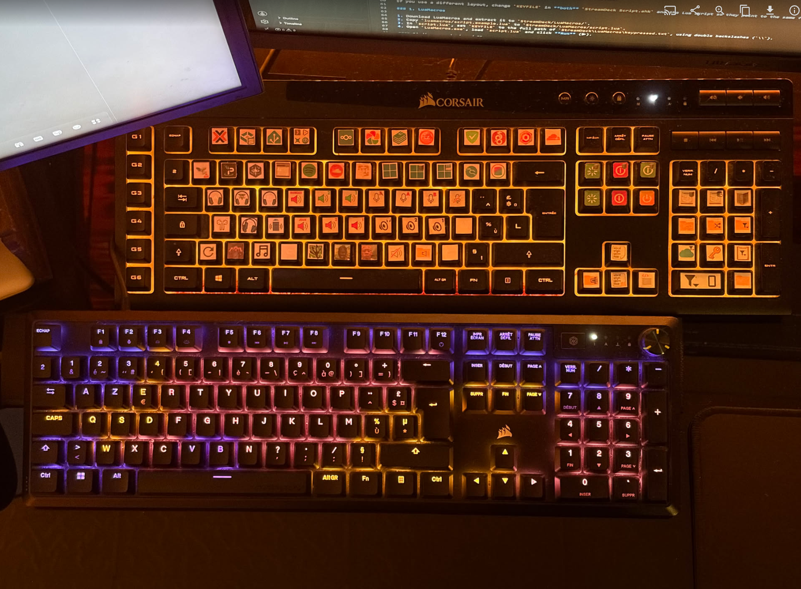

# Second Keyboard Stream Deck (AutoHotkey + LuaMacros)

Turn a cheap second USB keyboard into a programmable macro pad, like a Stream Deck. Every key on that keyboard can open a website, launch a program, send a shortcut, copy text to the clipboard and more. Your main keyboard keeps working normally.

This is an improved version of the setup I built in 2020 during the COVID lockdown and that I still use every day. The very first one was one long chain of `if` statements 💀. The script has changed a lot since, with this being the last version, adding Layers.

<!-- TODO: replace with a photo of your macro keyboard -->


## Features

- **Separate from your main keyboard**: keys pressed on the second keyboard are captured and never typed into the active window.
- **Many kinds of actions**: open URLs, programs, folders, files or shortcuts, send key combinations, copy text to the clipboard, or chain several actions on one key.
- **Layers**: one key switches the *whole* keyboard to a different set of actions (for example a "gaming" layer), and back.
- **Submenus**: press a key, then the next key picks an action from a submenu (for example `num1` then `num3`). Each layer can have its own submenus.
- **Double press**: different actions for a single and a double press of the same key.
- **Works with other apps**: send `F13`–`F24` combinations to trigger hotkeys in OBS, Discord, games and so on without clashing with real shortcuts.
- **Key map in its own file**: all actions live in `layers.ahk` as one line per key, so the engine never needs editing.

## How it works

```
 second keyboard ──► LuaMacros ──► writes "F1" to keypressed.txt ──► sends F24
                                                                        │
 AutoHotkey  ◄──────────────────────────────────────────────────────────┘
   ~F24:: reads keypressed.txt  ──►  looks up "F1" in the current layer  ──►  runs the action
```

Windows can't tell two keyboards apart, but **LuaMacros** can. It grabs every key from the second keyboard, so the key never reaches the focused window. It writes the key's name to a text file and sends `F24`, a key that doesn't exist on normal keyboards. **AutoHotkey** catches `F24`, reads the name, and runs the action you mapped to it.

## Requirements

- Windows
- [AutoHotkey **v1.1**](https://www.autohotkey.com/) (not v2: the script uses v1 syntax)
- [LuaMacros](https://github.com/stevedonovan/LuaMacro/releases/tag/2.5.0)
- A second USB keyboard (any keyboard works; a numpad alone works too)

## Repository layout

```
StreamDeck Script.ahk         engine: reads the key, handles layers / submenus / double press
layers.example.ahk            example key map  -> copy to layers.ahk
luamacros/
  script.example.lua          example LuaMacros script -> copy and configure
rdp/                          (optional, gitignored) .rdp files used by the key map
```

`layers.ahk`, `rdp/`, compiled `.exe` files and `keypressed.txt` are gitignored, so your personal URLs, IPs and paths are never committed.

## Setup

The scripts expect this folder structure by default:

```
StreamDeck/
├── AutoHotkey/      <- this repository
└── LuaMacros/       <- LuaMacros.exe, your script.lua, keypressed.txt
```

If you use a different layout, change `KEYFILE` in **both** `StreamDeck Script.ahk` and the Lua script so they point to the same file.

### 1. LuaMacros

1. Download LuaMacros and extract it to `StreamDeck/LuaMacros/`.
2. Copy `luamacros/script.example.lua` to `StreamDeck/LuaMacros/script.lua`.
3. In `script.lua`, set `KEYFILE` to the full path of `StreamDeck\LuaMacros\keypressed.txt`, using double backslashes (`\\`).
4. Open `LuaMacros.exe`, load `script.lua` and click **Run** (▶).

#### Finding your keyboard ID

On the first run (`KEYBOARD_ID = '0000AAA'`), LuaMacros asks you to press a key on the keyboard you want to use. It then prints every device: find the one named `MACROS` and copy the part of its system ID that identifies it (for example `112C6B52`) into `KEYBOARD_ID`. From then on the keyboard is recognised automatically at startup.

When you press a key, the LuaMacros console shows `Your key ID number is: ...` and the name it was mapped to. Unknown keys print `Not yet assigned: <code>`: add that code to the `config` table to use the key.

### 2. AutoHotkey

1. Install AutoHotkey v1.1.
2. Copy `layers.example.ahk` to `layers.ahk`.
3. Edit `layers.ahk` with your own actions (see below).
4. Run `StreamDeck Script.ahk`.

To start everything with Windows, put shortcuts to `LuaMacros.exe` and `StreamDeck Script.ahk` (or the compiled `.exe`) in `shell:startup`. LuaMacros can run a script on startup with `LuaMacros.exe -r "path\to\script.lua"`.

## Configuring keys

All configuration happens in `BuildLayers()` in `layers.ahk`. Each line maps a key name to an action:

```ahk
L := layers["default"] := {}

L["F1"]   := Open("https://example.com")
L["a"]    := Keys("^{F13}")
L[9]      := Tap(Open("calc.exe"), Open("notepad.exe"))
L["num1"] := SubMenu("subnum1")
L["tab"]  := ToggleLayer("alt")
```

### Actions

| Action | What it does | Example |
|---|---|---|
| `Open(target, ...)` | Runs one or more URLs, programs, folders, files or shortcuts | `Open("https://a.com", "https://b.com")` |
| `Keys(seq)` | Sends keys using the [AHK Send syntax](https://www.autohotkey.com/docs/v1/lib/Send.htm) | `Keys("^+{F5}")` |
| `Clip(text)` | Copies text to the clipboard | `Clip("C:\some\path")` |
| `Multi(a, b, ...)` | Runs several actions in order | `Multi(Open("x.exe"), Clip("text"))` |
| `Tap(single, double)` | One action on a single press, another on a double press | `Tap(Open("a.rdp"), Open("b.rdp"))` |
| `SubMenu(name)` | The next key press is looked up in that submenu | `SubMenu("subnum1")` |
| `ResetSubMenu()` | Closes an open submenu | `ResetSubMenu()` |
| `ToggleLayer(name)` | Switches the main layer to `name`, or back to `default` if `name` is already active | `ToggleLayer("alt")` |

**Modifiers in `Keys()`**: `^` Ctrl, `!` Alt, `+` Shift, `#` Win. Sending `F13`–`F24` with modifiers is a good way to trigger hotkeys in other apps (OBS, Discord, games…) without conflicting with real shortcuts.

### Key names

Key names are the strings from the `config` table in the Lua script:

| Group | Names |
|---|---|
| Letters | `a` … `z` |
| Number row | `0` … `9`, written as **integers**: `L[1]`, not `L["1"]` |
| Function keys | `F1` … `F13` |
| Numpad | `num0` … `num9`, `numPlus`, `numMinus`, `numMult`, `numDiv`, `numEnter`, `numDelete`, `numLock` |
| Navigation | `insert`, `home`, `pageup`, `delete`, `end`, `pagedown`, `up`, `down`, `left`, `right` |
| Others | `escape`, `tab`, `capslock`, `space`, `enter`, `backspace`, `rShift`, `rCtrl`, `alt` |
| Symbols | `comma`, `period`, `slash`, `semicolon`, `singlequote`, `leftbracket`, `rightbracket`, `minus`, `equals`, `backslash`, `inferior` (the `<>` key on ISO keyboards), `` ` `` |

Why the number row is different: AutoHotkey v1 stores `L[1]` and `L["1"]` as two different keys, and a `"1"` read from the file matches `L[1]`.

### Layers

A layer is one table of keys. `default` is active at startup.

```ahk
L := layers["default"] := {}
L["tab"] := ToggleLayer("alt")

L := layers["alt"] := {}
L["tab"] := ToggleLayer("default")    ; don't forget a way back
L["a"]   := Keys("^+{F1}")
```

While a layer is active, keys that aren't listed in it do nothing.

### Submenus

A submenu is a one-shot layer: the key press right after `SubMenu(...)` is looked up in it, and then you're back in the main layer.

```ahk
L["num1"] := SubMenu("subnum1")

S := layers["subnum1"] := {}
S["num1"] := Open("https://github.com")
S["num2"] := Open("https://www.youtube.com")
```

If the next key isn't in the submenu, the submenu closes and that key runs its normal action from the main layer.

### Double press

`Tap(single, double)` waits `DOUBLE_PRESS_MS` milliseconds (set at the top of `StreamDeck Script.ahk`) for a second press of the same key. Pressing a different key in the meantime runs the single-press action immediately. The single-press action is delayed by that timeout, so keep it short (300–500 ms feels responsive).

## Compiling

Right-click `StreamDeck Script.ahk` → **Compile Script** (or use Ahk2Exe). `layers.ahk` is bundled into the `.exe`, so after editing your key map you need to recompile, or just run the `.ahk` directly while experimenting.

## Troubleshooting

| Problem | Check |
|---|---|
| Nothing happens | Are both LuaMacros (script running) and the AHK script running? Does the LuaMacros console print the key when you press it? |
| LuaMacros prints the key, but AHK does nothing | `KEYFILE` must point to the same file in both scripts. Is the key name in `layers.ahk` spelled exactly like in the Lua `config` table? |
| Number-row keys don't work | Use `L[1]`, not `L["1"]`. |
| The keys are typed into the active window | LuaMacros isn't capturing that keyboard: check `KEYBOARD_ID`. |
| `Call to nonexistent function: BuildLayers` | `layers.ahk` is missing: copy it from `layers.example.ahk`. |
| Keys don't work in an app running as administrator | Run the AHK script as administrator too. |
